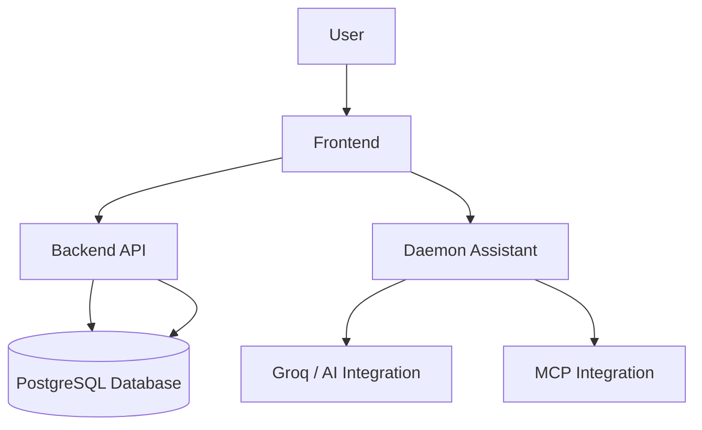
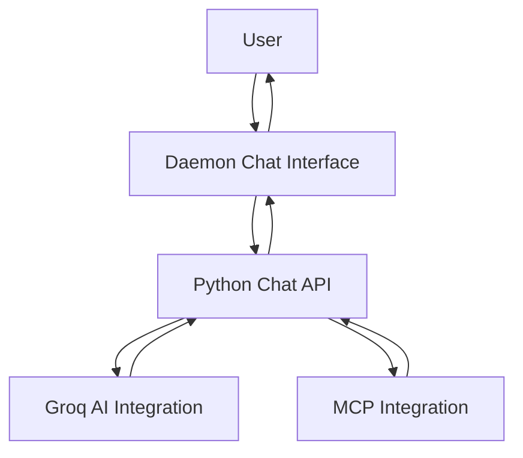

# Velvet Whispers

**Velvet Whispers** is a web-based movie and TV series platform focused on discovering, exploring, and organizing entertainment content, with an emphasis on vampire, supernatural, fantasy, and other creature-related stories.

The project combines a content-focused frontend, backend services, a PostgreSQL database, and **Daemon** — an AI-powered chatbot designed to provide an interactive assistant experience within the platform.

---

## Table of Contents

- [Overview](#overview)
- [Main Goals](#main-goals)
- [Core Features](#core-features)
- [System Architecture](#system-architecture)
- [Technology Stack](#technology-stack)
- [Project Structure](#project-structure)
- [Database](#database)
- [Daemon AI Assistant](#daemon-ai-assistant)
- [Image Asset Organization](#image-asset-organization)
- [Installation and Setup](#installation-and-setup)
- [Configuration](#configuration)
- [Development](#development)
- [Future Improvements](#future-improvements)

---

## Overview

Velvet Whispers aims to provide a centralized environment for exploring movies and television series, with structured information and a distinctive visual identity.

Instead of presenting entertainment titles as isolated entries, the platform organizes content around information such as:

- Titles and original titles.
- Posters and visual banners.
- Descriptions and background information.
- Genres and categories.
- Cast and crew information.
- Related movies and series.
- Seasons and episodes for television series.
- User-oriented content organization.

The platform also incorporates an AI assistant named **Daemon**, extending the experience beyond traditional content browsing.

## Main Goals

The project addresses several common limitations of general-purpose entertainment discovery platforms:

1. **Fragmented information** — relevant information about movies, series, characters, and related content can be scattered across different sources.
2. **Limited content relationships** — users may have difficulty discovering connections between movies, series, genres, and cast members.
3. **Unstructured content organization** — entertainment information benefits from a consistent data model and centralized storage.
4. **Limited interaction** — traditional content pages primarily display information rather than providing an interactive assistant.
5. **Inconsistent visual presentation** — a unified interface helps create a more coherent browsing experience.

## Core Features

### Movie and TV Series Exploration

The platform provides dedicated content pages for movies and television series.

Depending on the content type, a page can include:

- Title and original title.
- Poster and banner images.
- Description and background information.
- Trailer reference.
- Genre and category information.
- Cast and crew.
- Related titles.

For television series, the content structure can additionally include seasons and episodes.

### Content Organization

The database is designed to organize entertainment information through related entities, including:

- Movies and series.
- Genres.
- Cast and crew.
- Content-to-genre relationships.
- Content-to-cast relationships.
- Lore entries.
- User watchlists.
- User ratings.

### Daemon — AI Assistant

Daemon is an integrated AI-powered assistant intended to provide an additional interactive layer to the platform.

It is implemented as a separate Python service and integrated into the frontend.

### Responsive and Themed Interface

The frontend uses a distinctive dark visual identity inspired by supernatural and gothic aesthetics.

The interface is designed around content presentation, visual consistency, and accessible navigation.

---

## System Architecture

The project is organized into separate frontend, backend, and AI assistant components.



### Frontend Layer

Responsible for:

- Rendering the user interface.
- Displaying movies and series.
- Handling navigation and user interactions.
- Loading and presenting content images.
- Communicating with backend services.
- Providing the Daemon interface.

### Backend Layer

Responsible for application-side data operations and communication with the PostgreSQL database.

Its role includes handling requests from the frontend and working with stored platform information.

### Database Layer

PostgreSQL provides persistent storage for the platform's structured content and related information.

### AI Assistant Layer

Daemon operates as a separate service, allowing the AI-related functionality to remain separated from the main content-management logic.

---

## Technology Stack

| Technology | Purpose                          |
| ---------- | -------------------------------- |
| HTML       | Frontend structure               |
| CSS        | Styling and responsive interface |
| JavaScript | Frontend functionality           |
| PHP        | Backend/API functionality        |
| PostgreSQL | Relational database              |
| Python     | Daemon service                   |
| Groq       | AI model integration             |
| MCP        | Tool and context integration     |
| Git        | Version control                  |

*The exact versions and additional dependencies are defined by the project's configuration files.*

---

## Project Structure

The repository is organized into the following main directories:

```text
WhisperVelvet/
│
├── backend/                     # Backend application and API
│
├── daemon/                      # Daemon AI assistant service
│   ├── server.py                # Daemon service entry point
│   ├── chat_api.py              # Chat API implementation
│   ├── requirements.txt         # Python dependencies
│   └── .env.example             # Environment configuration example
│
├── docs/                        # Project documentation
│
├── frontend/                    # Frontend application
│   ├── assets/
│   │   └── images/              # Centralized image assets
│   │       └── cast/            # Cast-related images
│   │
│   ├── daemon.html              # Daemon interface
│   └── movieinfo.html           # Movie/series information page
│
├── index.html                   # Main entry page
├── check_images.py              # Image reference validation
├── reorganize_images.py         # Image organization utility
├── reorganize_frontend_images.py
│
├── image-reference-report.txt
├── image-reference-summary.txt
├── root-images.txt
│
├── .gitignore
├── .htaccess
├── robots.txt
└── sitemap.xml
```

The tree highlights the main application components and selected repository utilities. Individual files and additional folders may evolve during development.

---

## Database

The platform uses PostgreSQL as its relational database management system.

The database structure is designed to represent content and its relationships rather than storing all information in a single table.

The main entities include:

| Entity                   | Responsibility                             |
| ------------------------ | ------------------------------------------ |
| `users`                  | User information                           |
| `movies_series`          | Movie and television series records        |
| `genres`                 | Available genres                           |
| `movie_series_genres`    | Relationship between content and genres    |
| `cast_crew`              | Cast and crew information                  |
| `movie_series_cast_crew` | Relationship between content and cast/crew |
| `lore_entries`           | Additional universe and lore information   |
| `user_watchlists`        | User watchlist records                     |
| `user_ratings`           | User ratings                               |

The relationship tables support many-to-many relationships between content, genres, and cast members.

---

## Daemon AI Assistant

**Daemon** is the AI assistant component integrated into Velvet Whispers.

It is maintained separately from the main frontend and backend components.

### Architecture



### Main Components

- **`server.py`** — Python service entry point.
- **`chat_api.py`** — Chat API implementation.
- **`requirements.txt`** — Python package dependencies.
- **`.env.example`** — Example environment configuration.
- **`daemon.html`** — Frontend interface for the assistant.

### Configuration

Daemon requires its environment variables to be configured locally.

Create a `.env` file based on the provided `.env.example` file and supply the required values.

**Important:** Never commit API keys, tokens, passwords, or other secret values to the repository.

---

## Image Asset Organization

The project's image assets are centralized under:

```text
frontend/
└── assets/
    └── images/
        ├── cast/
        ├── posters/
        ├── banners/
        └── other images...
```

The exact subdirectories may vary according to the current asset collection.

This organization provides several benefits:

- Centralized image storage.
- Clearer separation between application code and media files.
- More consistent relative image references.
- Easier maintenance and replacement of images.
- Reduced duplication across frontend pages.

The repository also contains image-reference validation utilities.

Run the following command from the project root to check image references:

```bash
python3 check_images.py
```

---

## Installation and Setup

### Prerequisites

Before running the project, make sure the following tools are available:

- Git
- A local web server with PHP support
- PostgreSQL
- Python
- Node.js, if required by the frontend tooling

### 1. Clone the Repository

```bash
git clone https://github.com/mooseer20/WhisperVelvet.git

cd WhisperVelvet
```

### 2. Configure the Database

Create a PostgreSQL database for the project.

The database connection settings must match the configuration expected by the backend.

Import the project's database schema and initial data if provided.

### 3. Configure the Backend

Review the backend configuration files and provide the required database connection details.

Keep local credentials outside version control.

### 4. Configure Daemon

Navigate to the Daemon directory:

```bash
cd daemon
```

Create a local environment file using the example configuration:

```bash
cp .env.example .env
```

Install the Python dependencies:

```bash
python3 -m venv daemon-venv

source daemon-venv/bin/activate

pip install -r requirements.txt
```

Add the required configuration values to `.env`.

### 5. Run the Application

Start the frontend and backend using the local PHP-compatible web server configured for the project.

Start the Daemon Python service using the entry point and command defined by its implementation.

*The exact launch commands and ports should be confirmed against the current backend and Daemon configuration before publishing this README as final setup documentation.*

---

## Configuration

Configuration values should be maintained locally rather than committed to Git.

Typical configuration categories include:

| Configuration         | Description                |
| --------------------- | -------------------------- |
| Database host         | PostgreSQL server address  |
| Database port         | PostgreSQL connection port |
| Database name         | Project database           |
| Database username     | Database account           |
| Database password     | Local database credential  |
| Groq API key          | AI service authentication  |
| Service configuration | Local service settings     |

Use `.env.example` as the reference for the exact variable names required by Daemon.

Do not publish `.env` files or expose credentials in commits.

---

## Development

The project is developed as a modular application, with separate responsibilities for the frontend, backend, database, and AI assistant.

### Image Validation

```bash
python3 check_images.py
```

Use this utility after moving, renaming, or adding frontend images to identify broken references.

### Version Control

The repository uses Git for source control.

Development changes should be organized into focused commits, separating independent changes such as:

- Frontend asset restructuring.
- Backend improvements.
- Daemon functionality.
- Interface updates.
- Database changes.

---

## Future Improvements

Potential areas for further development include:

- Expanded movie and series discovery.
- More detailed content relationships.
- Improved filtering and search.
- Enhanced user watchlist functionality.
- Additional Daemon capabilities.
- More comprehensive error handling and input validation.
- Improved API documentation.
- Automated testing and validation.

---

## License

A license should be specified in the repository before defining the terms under which the project may be used, modified, or distributed.

---

## Author

**Velvet Whispers  - Sarmen Apresyan**

